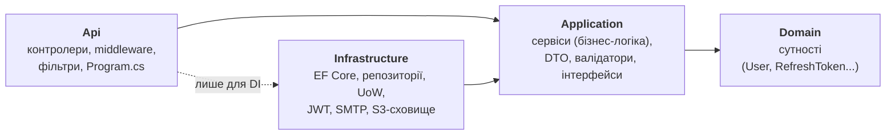
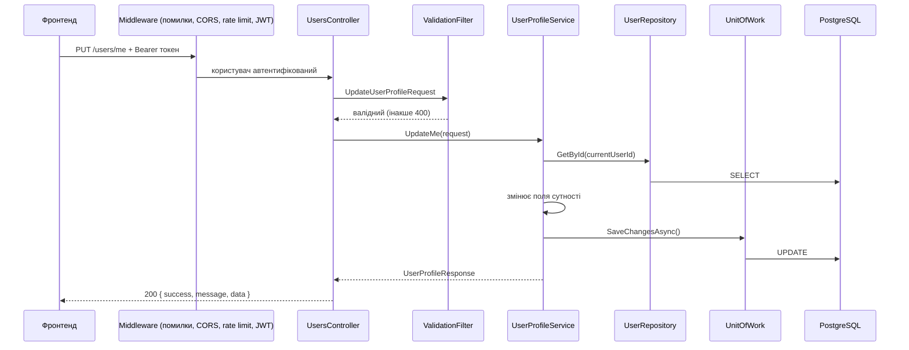
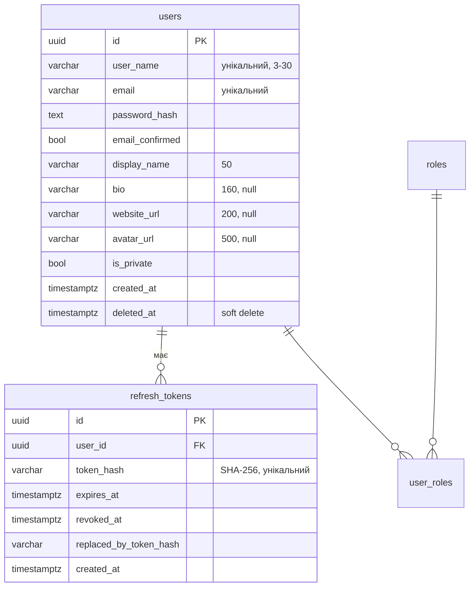

# Архітектура backend

## Коротко

- **Модульний моноліт** на принципах **Clean Architecture**: один застосунок (ASP.NET Core Web API, .NET 10), одна БД,
  але код поділений на шари й модулі з чіткими межами.
- **PostgreSQL** (EF Core + Npgsql, міграції), **ASP.NET Core Identity** + **JWT** (access + refresh).
- **Repository + Service + Unit of Work**.
- **Docker**: локальні залежності через `docker-compose.yml`, API — у Docker-образі.
- **Хостинг (staging):** Render (Docker-контейнер API) + Neon (PostgreSQL) + Supabase Storage (файли, S3 API) +
  Brevo (SMTP) + UptimeRobot (моніторинг). Production — за тим самим шаблоном пізніше. Деталі — [deployment.md](deployment.md).

## Шари



| Шар | Що містить | Від чого залежить |
|---|---|---|
| `SocialNetwork.Domain` | Сутності (`User`, `RefreshToken`), `BaseEntity`, `ISoftDeletable` | ні від чого (лише Identity-модель для `User`) |
| `SocialNetwork.Application` | Сервіси, інтерфейси репозиторіїв і зовнішніх сервісів, Request/Response, валідатори, винятки | Domain |
| `SocialNetwork.Infrastructure` | `AppDbContext`, конфігурації таблиць, міграції, репозиторії, `UnitOfWork`, `JwtTokenService`, `SmtpEmailSender`, `S3FileStorage` | Application |
| `SocialNetwork.Api` | Контролери, `GlobalExceptionHandlingMiddleware`, `ValidationFilter`, JWT/CORS/rate limiting, OpenAPI | Application (+ Infrastructure для реєстрації DI) |

**Головне правило:** залежності спрямовані **всередину**. Application не знає про EF Core, SMTP чи хмарні сервіси —
лише про інтерфейси (`IUserRepository`, `IEmailSender`, `IFileStorage`). Тому їх легко підмінити в тестах
і замінити реалізацію без змін бізнес-логіки. Приклад з життя проєкту: сховище файлів перейшло з Azure Blob
на S3 (Supabase) — змінився лише один клас в Infrastructure (`S3FileStorage`) і конфігурація.

> Компроміс: `User` наслідує `IdentityUser<Guid>`, а сервіси використовують `UserManager<User>`.
> Це додає Domain/Application залежність від пакета `Microsoft.Extensions.Identity.Stores`,
> зате не треба писати власне хешування паролів, токени скидання тощо.

## Модулі

Модуль — це папка з однаковою назвою в кожному шарі:

```
Domain/Users              Application/Users              Infrastructure/Persistence/Configurations/Users
Domain/Auth               Application/Auth               Infrastructure/Persistence/Configurations/Auth
(далі) Domain/Posts       Application/Posts              ...
```

Поточні модулі: **Auth** (реєстрація, вхід, токени, email), **Users** (кабінет).
Заплановані за ТЗ: Posts/Media, Stories, Reels, Social (likes, comments, follows, saved), Direct (чат, SignalR),
Notifications, Explore/Search, Settings.

**Правило меж:** модуль не використовує репозиторії іншого модуля напряму — лише його сервіс-інтерфейс
(приклад: `UserProfileService` після зміни пароля викликає `IAuthService.RevokeAllSessions`, а не `IRefreshTokenRepository`).

## Чому модульний моноліт, а не мікросервіси

| Критерій | Модульний моноліт | Мікросервіси |
|---|---|---|
| Час до робочого MVP (1 backend-розробник) | ✅ швидко | ❌ у 2–3 рази довше: кожен сервіс — свій проєкт, БД, Dockerfile, деплой |
| Стрічка, Explore, лічильники (дані з багатьох модулів) | ✅ один SQL-запит з JOIN | ❌ кілька HTTP-викликів між сервісами + агрегація |
| Транзакції (напр. «прийняти запит на підписку + сповіщення») | ✅ звичайна транзакція БД | ❌ saga / outbox |
| Інфраструктура | ✅ API + PostgreSQL | ❌ + API gateway, брокер (RabbitMQ), розподілене трасування |
| Вартість хостингу (безкоштовні тарифи) | ✅ 1 сервіс + 1 БД — вкладаємося у free | ❌ ресурс на кожен сервіс — free-лімітів не вистачить |
| Дебаг, тести, навчання | ✅ один процес | ❌ треба піднімати всі сервіси |
| Незалежне масштабування частин | ❌ масштабується цілком | ✅ |
| Ізоляція збоїв | ❌ збій модуля може покласти API | ✅ |

Для навчального MVP командою з двох розробників переваги мікросервісів (незалежне масштабування, різні команди
на різні сервіси) не потрібні, а їхня ціна — дуже висока. ТЗ вимагає, щоб код був «структурований і придатний
до розширення» — це забезпечують шари й межі модулів.

### Як винести модуль у мікросервіс, якщо знадобиться

1. Модуль уже має власні інтерфейси й не ходить у чужі таблиці — його Application/Infrastructure-папки
   переносяться в окремий проєкт майже без змін.
2. Виклики сервіс-інтерфейсу іншого модуля замінюються на HTTP-клієнт або події через брокер (з outbox-патерном).
3. Окрема БД (або окрема схема) для модуля.

Найкращі кандидати: **Notifications** (асинхронний, природно працює на подіях) і **Media** (важке
завантаження/обробка відео, інший профіль навантаження).

## Як проходить запит



Якщо будь-де кидається виняток (`NotFoundException`, `ConflictException`, `ValidationException`...),
`GlobalExceptionHandlingMiddleware` перетворює його на відповідь з потрібним статусом:

```json
{ "success": false, "message": "Помилка валідації.", "errors": { "Username": ["..."] } }
```

## Автентифікація

- **Access-токен** — JWT (HMAC-SHA256), живе 15 хв, містить `sub` (Id), `email`, `unique_name`, `jti`.
  Фронт надсилає його в заголовку `Authorization: Bearer ...`.
- **Refresh-токен** — випадкові 64 байти, живе 7 днів. У БД — лише **SHA-256 хеш**.
- **Ротація:** кожен `/auth/refresh` відкликає старий токен і видає новий (`ReplacedByTokenHash` — ланцюжок).
- **Виявлення крадіжки:** якщо приходить уже відкликаний токен — відкликаються **всі** сесії користувача.
- Зміна/скидання пароля теж відкликають усі сесії.
- **Захист від перебору:** блокування акаунта після 5 невдалих спроб (15 хв) + rate limiting по IP
  (5 запитів/хв на register, login, forgot-password, reset-password).
- Однакова відповідь 401 для «немає користувача» і «невірний пароль»; `forgot-password` завжди відповідає 200 —
  щоб не можна було перевірити, чи зареєстрований email.
- Токени підтвердження email і скидання пароля генерує Identity (діють 3 год, прив'язані до security stamp —
  після зміни пароля старі посилання недійсні). Ключі Data Protection зберігаються в БД (`data_protection_keys`).

## Схема БД



Також таблиці Identity (`user_claims`, `user_logins`, `user_tokens`, `role_claims`) і `data_protection_keys`.
Назви таблиць і колонок — у `snake_case` (стандарт PostgreSQL), налаштовано через `UseSnakeCaseNamingConvention()`.

Заплановані зв'язки: `follows (follower_id, following_id)` — self-referencing many-to-many;
`posts (author_id → users)`; `media (post_id → posts)`; `stories`, `comments`, `likes`, `saved_posts`,
`chats`, `messages`, `notifications`, `chat_themes`.

## Середовища

| | Local | Staging | Production |
|---|---|---|---|
| Гілка | будь-яка | `dev` | `main` (ще не налаштовано) |
| API | Rider / `dotnet run` (або `docker compose --profile full`) | Render, Docker-контейнер (free) | Render (за тим самим `render.yaml`) |
| БД | PostgreSQL у Docker | Neon (окремий проєкт) | Neon (окремий проєкт) |
| Файли | RustFS у Docker (S3) | Supabase Storage (S3), bucket `media` | Supabase Storage (S3) |
| Пошта | smtp4dev у Docker | Brevo SMTP | Brevo SMTP |
| Секрети | `dotnet user-secrets` | змінні Render + GitHub Environment `staging` | змінні Render + GitHub Environment `production` |
| Документація API | `/scalar` | `/scalar` (`OpenApi__Enabled=true`) | вимкнено |

**CI/CD (GitHub Actions):** `ci.yml` — збірка і тести на кожен PR; `deploy-staging.yml` — на push у `dev`:
тести → міграції БД (Neon) → Render Deploy Hook (Render збирає `Dockerfile`) → перевірка `/health`.
Інфраструктура сервісу описана кодом у `render.yaml` (Render Blueprint). Покроково — [deployment.md](deployment.md).

## Резервне копіювання та відновлення

- **Щоденний дамп:** `.github/workflows/backup.yml` о 03:00 UTC робить `pg_dump` staging-БД і зберігає його
  як GitHub artifact 14 днів (scheduled-запуски працюють з гілки `main`).
- **Neon** додатково дозволяє відновити БД на момент у недалекому минулому (глибина історії залежить від тарифу).
- **Відновлення з дампу:**
  ```bash
  docker run --rm -v "$PWD:/backup" postgres:17 \
    pg_restore --clean --if-exists --no-owner -d "<STAGING_DB_URL>" /backup/staging-<дата>.dump
  ```
  Деталі — [deployment.md](deployment.md#бекап-і-відновлення).

## Моніторинг і логи

- `GET /health` — API живий **і** БД доступна (перевірка після деплою).
- `GET /health/live` — лише «процес працює», без БД. Його перевіряє Render (health check) і пінгує **UptimeRobot**
  кожні 5 хв: free-сервіс Render не засинає, а БД Neon може засинати й не витрачає безкоштовний ліміт обчислень.
  UptimeRobot також надсилає лист, якщо API недоступний. Публічна сторінка доступності: https://stats.uptimerobot.com/QX76uZtgtw
- Успішні запити до `/health*` не пишуться в логи (рівень Verbose), щоб не засмічувати їх перевірками кожні 5 секунд;
  помилки health-перевірок логуються як Error.
- Логи — Serilog у stdout: локально в консолі, на Render — вкладка **Logs** сервісу.
- Необроблені помилки логуються з `traceId`; клієнт у production бачить лише «Внутрішня помилка сервера» + `traceId`.
